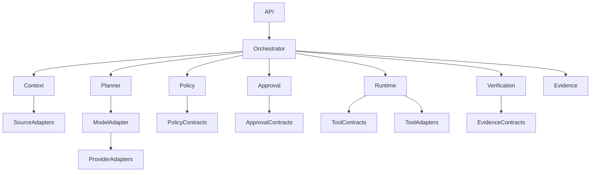

# NAEOS Intelligence — Component Boundaries

**Document ID:** NAEOS-INT-ARCH-002  
**Version:** 1.0.0  
**Status:** Accepted  
**Audience:** Maintainers, architects, contributors, and security reviewers

---

## 1. Purpose

This document defines the boundaries, responsibilities, dependency rules, and interaction contracts between NAEOS Intelligence components.

Its primary objectives are to:

- Prevent architectural coupling.
- Separate reasoning from authorization and execution.
- Make modules independently testable.
- Establish explicit interfaces.
- Preserve auditability and security invariants.

This document is governed by `DOCUMENTATION-AUTHORITY.md` and is subordinate to `SYSTEM-ARCHITECTURE.md`.

## 2. Architectural Invariants

The following invariants MUST be preserved:

### INV-001 — Intelligence Is Not Authority

The Model and Planner MUST NOT grant permissions or directly execute actions.

### INV-002 — Policy Is the Authorization Boundary

All executable actions MUST pass through the Policy Engine.

### INV-003 — Runtime Enforces Authorization

The Runtime MUST independently validate authorization before executing an action.

### INV-004 — Explicit Contracts

Module interactions MUST use explicit interfaces and typed contracts.

### INV-005 — Fail Closed

An absent, invalid, expired, or indeterminate authorization decision MUST prevent execution.

### INV-006 — Evidence Is Separate from Reasoning

Model-generated summaries MUST NOT be treated as authoritative execution evidence.

### INV-007 — Least Privilege

Each component MUST receive only the capabilities necessary for its responsibilities.

## 3. Component Responsibilities

| Component | Primary Responsibility | Must Not |
|---|---|---|
| API | Request intake and validation | Authorize model proposals |
| Orchestrator | Coordinate lifecycle | Bypass policy |
| Context | Retrieve authorized information | Grant execution permissions |
| Planner | Generate plans and proposals | Execute tools |
| Model Adapter | Invoke AI providers | Define runtime permissions |
| Policy Engine | Evaluate action authorization | Execute tools |
| Approval | Collect and validate human approval | Independently grant broad permissions |
| Runtime | Execute authorized actions | Accept arbitrary model commands |
| Verification | Assess observed outcomes | Invent evidence |
| Evidence | Persist traceable records | Treat proposals as completed actions |
| Observability | Collect operational telemetry | Replace audit evidence |

## 4. Dependency Rules

### 4.1 Allowed Dependencies



The diagram is conceptual. Shared contracts SHOULD be defined in dedicated packages with minimal dependencies.

### 4.2 Forbidden Dependencies

The following dependencies MUST NOT exist:

- Planner → Runtime implementation.
- Model Adapter → Policy implementation.
- Model Adapter → Approval implementation.
- Context Retrieval → Runtime implementation.
- Tool Adapter → Planner implementation.
- Model output → direct authorization.
- External provider SDK → core domain contracts.
- NAEOS Core internal package → Intelligence internal implementation.

The Planner may produce an action proposal that is passed to the Policy Engine through the Orchestrator. It must not invoke the Runtime directly.

## 5. Contract Definitions

### 5.1 Intelligence Plan

A plan SHOULD contain:

- Plan identifier.
- Request identifier.
- Plan version.
- Proposed steps.
- Dependencies.
- Expected outcomes.
- Risk classifications.
- Verification requirements.

A plan is descriptive and is not an authorization artifact.

### 5.2 Action Proposal

An action proposal SHOULD contain:

- Proposal identifier.
- Request identifier.
- Action type.
- Target resource.
- Canonical action parameters.
- Requested capabilities.
- Risk classification.
- Provenance references.
- Proposed expiration.

The proposal MUST be immutable after authorization evaluation. A materially modified proposal requires a new policy decision.

### 5.3 Policy Decision

A policy decision SHOULD contain:

- Decision identifier.
- Proposal identifier.
- Decision status.
- Applicable policy identifier and version.
- Authorization constraints.
- Approval requirement.
- Decision timestamp.
- Expiration.
- Reason codes.

Decision statuses:

- `allow`
- `deny`
- `require_approval`
- `indeterminate`

`indeterminate` MUST be treated as denial for execution purposes.

### 5.4 Approval Record

An approval record SHOULD contain:

- Approval identifier.
- Proposal identifier.
- Approver identity.
- Approval decision.
- Approval timestamp.
- Expiration.
- Bound action digest.
- Relevant policy version.

Approval MUST be bound to the specific action proposal.

### 5.5 Execution Record

An execution record SHOULD contain:

- Execution identifier.
- Proposal identifier.
- Policy decision identifier.
- Approval identifier, if applicable.
- Tool identifier and version.
- Execution status.
- Start and completion timestamps.
- Output evidence references.
- Failure details where applicable.

### 5.6 Verification Record

A verification record SHOULD contain:

- Verification identifier.
- Execution identifier.
- Verification method.
- Expected outcome.
- Observed outcome.
- Result.
- Evidence references.
- Verification timestamp.

Verification results:

- `verified`
- `failed`
- `inconclusive`

## 6. Interface Boundaries

### 6.1 Planner Interface

The Planner SHOULD expose a contract conceptually equivalent to:

```go
type Planner interface {
    CreatePlan(
        ctx context.Context,
        input PlanningInput,
    ) (Plan, error)
}
```

The Planner returns a proposal or plan only.

### 6.2 Policy Interface

```go
type PolicyEvaluator interface {
    Evaluate(
        ctx context.Context,
        proposal ActionProposal,
    ) (PolicyDecision, error)
}
```

The Policy Engine evaluates authorization using trusted policy and identity context.

### 6.3 Approval Interface

```go
type ApprovalService interface {
    RequestApproval(
        ctx context.Context,
        request ApprovalRequest,
    ) (ApprovalRecord, error)

    ValidateApproval(
        ctx context.Context,
        approval ApprovalRecord,
        proposal ActionProposal,
    ) error
}
```

Approval validation MUST verify that the approval is valid for the exact proposal.

### 6.4 Runtime Interface

```go
type ToolRuntime interface {
    Execute(
        ctx context.Context,
        request AuthorizedExecution,
    ) (ExecutionRecord, error)
}
```

`AuthorizedExecution` MUST be a trusted, validated runtime input. It MUST NOT be constructed solely from model output.

### 6.5 Verification Interface

```go
type Verifier interface {
    Verify(
        ctx context.Context,
        execution ExecutionRecord,
        requirements VerificationRequirements,
    ) (VerificationRecord, error)
}
```

Verification SHOULD use independent observations where feasible.

These interface signatures are illustrative. Their final form MUST be aligned with the repository implementation and selected Go version.

## 7. Authorization and Execution Flow

The required logical sequence is:

1. Planner generates a plan.
2. Orchestrator extracts an action proposal.
3. Policy Engine evaluates the proposal.
4. If approval is required, Approval Workflow obtains approval.
5. Runtime revalidates authorization at the final controllable boundary.
6. Runtime executes the action.
7. Evidence is recorded.
8. Verification evaluates the observed outcome.
9. Orchestrator returns the result.

No component may reorder these steps in a way that bypasses authorization.

## 8. Data Ownership

| Data | Owning Component |
|---|---|
| Request lifecycle | Orchestrator |
| Retrieved context metadata | Context Retrieval |
| Plan and proposal | Planner |
| Policy decision | Policy Engine |
| Approval record | Approval Workflow |
| Execution record | Runtime |
| Verification record | Verification Engine |
| Audit events | Evidence subsystem |
| Operational telemetry | Observability subsystem |

Ownership refers to logical responsibility. Physical persistence may be centralized initially.

## 9. Error Propagation

Components MUST use typed or structured errors where practical.

Errors SHOULD distinguish:

- Validation failure.
- Authorization denial.
- Approval required.
- Approval expired.
- Policy unavailable.
- Provider failure.
- Tool execution failure.
- Verification failure.
- Evidence persistence failure.
- Unsupported contract version.

The Orchestrator MUST NOT convert an authorization failure into an executable action.

## 10. Testing Requirements

Each component MUST have unit tests for its responsibilities.

Integration tests SHOULD cover:

- Planner output passed to Policy Engine.
- Policy denial preventing Runtime invocation.
- Approval expiration preventing execution.
- Proposal mutation invalidating authorization.
- Runtime authorization revalidation.
- Tool failure being recorded.
- Verification returning `inconclusive`.
- Evidence persistence failure.
- Unsupported policy or contract version.
- Model output containing unauthorized action instructions.

Tests MUST verify that denied actions are not executed.

## 11. Change Management

Changes to component boundaries MUST:

1. Identify affected modules.
2. Describe dependency changes.
3. Assess security implications.
4. Update interface contracts.
5. Update architecture documentation.
6. Add or modify tests.
7. Consider an Architecture Decision Record.

New direct dependencies between Planner, Policy, Approval, and Runtime require explicit architecture review.

## 12. Document Governance

This document is governed by `DOCUMENTATION-AUTHORITY.md`.

The requirements defined in this document are proposed until formally reviewed and accepted by the project maintainers.
