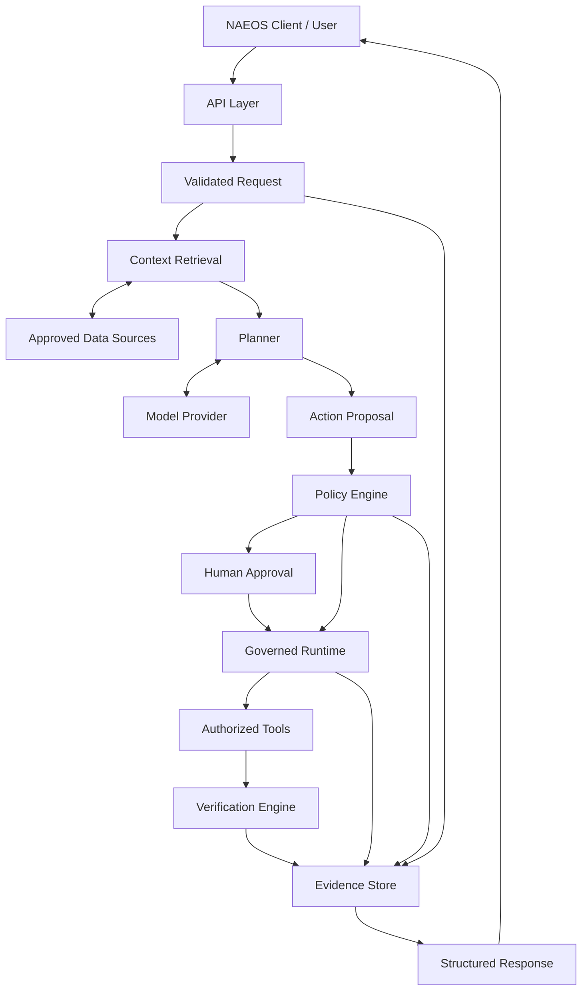
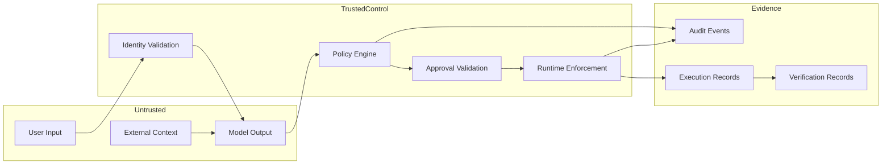

# NAEOS Intelligence — Data Flow

**Document ID:** NAEOS-INT-ARCH-003  
**Version:** 1.0.0  
**Status:** Accepted  
**Audience:** Maintainers, architects, contributors, and security reviewers

---

## 1. Purpose

This document defines how data flows through NAEOS Intelligence.

It describes:

- Data sources and consumers.
- Request processing.
- Context retrieval.
- Plan and action proposal generation.
- Authorization and approval.
- Governed execution.
- Verification.
- Evidence persistence.
- Trust boundaries.

This document is governed by `DOCUMENTATION-AUTHORITY.md`, `SYSTEM-ARCHITECTURE.md`, and `COMPONENT-BOUNDARIES.md`.

## 2. Data Flow Principles

The following principles MUST apply:

### DFP-001 — Provenance

Data retrieved from external systems MUST retain source provenance where applicable.

### DFP-002 — Trust Separation

Untrusted context and model-generated content MUST remain distinguishable from trusted policy decisions.

### DFP-003 — Authorization Integrity

Execution data MUST be bound to the applicable authorization decision.

### DFP-004 — Minimal Data

Components SHOULD process only the data necessary for their responsibilities.

### DFP-005 — Traceability

Security-relevant data transitions MUST be traceable through correlation identifiers.

### DFP-006 — Evidence Durability

Security-sensitive decisions and execution outcomes MUST be persisted as durable records.

### DFP-007 — Fail Closed

Required validation, authorization, or evidence persistence failures MUST NOT result in implicit execution permission.

## 3. High-Level Data Flow

This diagram represents the logical flow. Conditional branches and approval requirements are determined by policy.

## 4. Data Categories

| Data Category | Examples | Trust Classification |
|---|---|---|
| Request data | User intent, parameters | Untrusted input |
| Identity data | Authenticated principal, roles | Trusted after validation |
| Context data | Repository files, issue text | Untrusted external content |
| Model output | Plans, recommendations | Untrusted generated content |
| Action proposal | Tool name, target, parameters | Untrusted until evaluated |
| Policy data | Rules, policy versions | Trusted configuration |
| Policy decision | Allow, deny, approval required | Trusted after validation |
| Approval data | Approver identity, decision | Trusted after validation |
| Execution data | Tool result, status | Observed operational data |
| Verification data | Expected vs. observed outcome | Evidence-backed result |
| Audit data | Decision and execution events | Durable security records |
| Telemetry | Logs, metrics, traces | Operational data |

## 5. Flow A — Request Intake

### 5.1 Input

A client submits a structured request.

### 5.2 Processing

The API Layer:

1. Authenticates the caller.
2. Validates the request schema.
3. Checks request size and rate limits.
4. Generates a request identifier.
5. Establishes a correlation identifier.
6. Records the initial request event.

### 5.3 Output

A validated request enters the Orchestrator.

### 5.4 Security Requirements

- Authentication MUST precede protected context access.
- Invalid requests MUST be rejected.
- Credentials MUST NOT be stored in request payloads or logs.
- Request identifiers MUST NOT be treated as authorization tokens.

## 6. Flow B — Context Retrieval

### 6.1 Input

Validated request and authenticated principal.

### 6.2 Processing

Context Retrieval:

1. Determines required context sources.
2. Checks source-level access permissions.
3. Retrieves authorized information.
4. Normalizes retrieved data.
5. Attaches provenance metadata.
6. Applies relevance filtering.
7. Returns context to the Planner.

### 6.3 Provenance Metadata

Context records SHOULD include:

- Source type.
- Source identifier.
- Source location or reference.
- Retrieval timestamp.
- Source version or revision where available.
- Access scope.
- Content digest where appropriate.

### 6.4 Security Requirements

Retrieved content MUST be treated as untrusted.

Instructions embedded in repository files, issue descriptions, comments, or external documents MUST NOT override system policy or runtime authorization.

## 7. Flow C — Plan Generation

### 7.1 Input

Request intent and retrieved context.

### 7.2 Processing

The Planner:

1. Classifies intent.
2. Decomposes the task.
3. Identifies dependencies.
4. Generates expected outcomes.
5. Identifies risks.
6. Produces a structured plan.

The Model Provider may be invoked during this process.

### 7.3 Output

A plan containing proposed steps and expected outcomes.

### 7.4 Security Requirements

Model-generated output MUST be schema-validated.

The Planner MUST NOT directly invoke privileged tools.

The plan MUST NOT be interpreted as an authorization decision.

## 8. Flow D — Action Proposal

### 8.1 Input

A structured plan.

### 8.2 Processing

The Orchestrator derives action proposals from plan steps that require tool execution.

Each proposal MUST identify:

- Proposal ID.
- Request ID.
- Action type.
- Target.
- Parameters.
- Requested capability.
- Provenance references.
- Proposal digest.
- Expiration.

### 8.3 Output

An immutable action proposal submitted to the Policy Engine.

### 8.4 Security Requirements

Any material change to the action, target, or parameters MUST invalidate the prior authorization binding.

## 9. Flow E — Policy Evaluation

### 9.1 Input

Action proposal, authenticated principal, trusted policy configuration, and relevant resource state.

### 9.2 Processing

The Policy Engine:

1. Validates the proposal.
2. Resolves applicable policies.
3. Evaluates permissions.
4. Applies constraints.
5. Determines approval requirements.
6. Produces a policy decision.

### 9.3 Decision Outcomes

| Decision | Behavior |
|---|---|
| `allow` | Proceed subject to runtime revalidation |
| `deny` | Stop execution |
| `require_approval` | Initiate approval workflow |
| `indeterminate` | Deny execution |

### 9.4 Security Requirements

Policy decisions MUST be bound to the proposal and policy version.

Model output MUST NOT influence authorization through unvalidated claims.

## 10. Flow F — Human Approval

### 10.1 Input

Proposal and policy decision requiring approval.

### 10.2 Processing

The Approval Workflow:

1. Presents action details to an authorized approver.
2. Validates approver identity.
3. Records approval or rejection.
4. Binds the approval to the proposal.
5. Enforces expiration.

### 10.3 Output

A validated approval record or a rejected action.

### 10.4 Security Requirements

Approval MUST NOT be reusable for materially different actions.

Expired, missing, or invalid approval MUST prevent execution.

## 11. Flow G — Governed Execution

### 11.1 Input

Authorized execution request.

### 11.2 Processing

The Runtime:

1. Validates the action contract.
2. Validates the policy decision.
3. Revalidates authorization at the final controllable boundary.
4. Validates approval if required.
5. Checks tool permissions.
6. Applies execution limits.
7. Invokes the approved tool.
8. Records execution outcome.

### 11.3 Output

Execution record and observed tool output.

### 11.4 Security Requirements

- Runtime MUST execute only registered tools.
- Tool permissions MUST be explicit.
- Arbitrary shell execution is excluded from the MVP.
- Runtime MUST NOT trust model-generated authorization claims.
- External side effects MUST be subject to policy and approval requirements.

## 12. Flow H — Verification

### 12.1 Input

Execution record and verification requirements.

### 12.2 Processing

The Verification Engine:

1. Determines the required verification method.
2. Retrieves independent observations where possible.
3. Compares observed results with expected outcomes.
4. Produces a verification record.

### 12.3 Output

One of the following:

- `verified`
- `failed`
- `inconclusive`

### 12.4 Security Requirements

Verification MUST NOT fabricate results.

An execution marked successful by a tool MUST NOT automatically be represented as independently verified.

## 13. Flow I — Evidence Persistence

### 13.1 Events

The following events SHOULD be recorded:

- `request.received`
- `request.validated`
- `context.retrieved`
- `plan.generated`
- `action.proposed`
- `policy.evaluated`
- `approval.requested`
- `approval.decided`
- `execution.started`
- `execution.completed`
- `execution.failed`
- `verification.completed`
- `request.completed`

### 13.2 Event Attributes

Events SHOULD contain:

- Event ID.
- Request ID.
- Correlation ID.
- Event type.
- Timestamp.
- Actor or component identity.
- Related proposal ID.
- Related decision ID.
- Related execution ID.
- Evidence references.

### 13.3 Persistence Requirements

Security-relevant events MUST be persisted.

The system MUST distinguish between:

- Proposed actions.
- Authorization decisions.
- Executed actions.
- Observed outcomes.

A generated plan MUST NOT be treated as evidence of execution.

## 14. Data Trust Boundaries

The trust boundary MUST be enforced through software controls, not natural-language instructions.

## 15. Data Retention and Privacy

The MVP SHOULD define:

- Request retention periods.
- Audit event retention periods.
- Execution record retention periods.
- Model input and output retention behavior.
- Sensitive-data redaction rules.
- Data deletion and export procedures.

Retention policy MUST be documented before production deployment.

Sensitive information SHOULD be minimized or redacted from model inputs, logs, and persisted records where appropriate.

## 16. Failure Scenarios

| Failure | Required Behavior |
|---|---|
| Authentication failure | Reject request |
| Context access denied | Reject unauthorized retrieval |
| Context source unavailable | Return explicit failure or partial-context status |
| Invalid model output | Reject output and prevent unsafe execution |
| Policy engine unavailable | Deny execution |
| Approval expired | Deny execution |
| Proposal digest mismatch | Invalidate authorization |
| Tool unavailable | Record execution failure |
| Verification unavailable | Mark outcome inconclusive |
| Evidence persistence unavailable | Do not report required evidence-backed completion |
| Unsupported contract version | Reject request |

## 17. Data Flow Testing

Tests SHOULD validate:

- Data provenance preservation.
- Context access enforcement.
- Model output schema validation.
- Proposal digest integrity.
- Policy decision binding.
- Approval binding and expiration.
- Runtime revalidation.
- Execution evidence persistence.
- Verification outcome accuracy.
- Fail-closed behavior.
- Sensitive-data redaction.

## 18. Document Governance

This document is governed by `DOCUMENTATION-AUTHORITY.md`.

Any changes affecting data trust boundaries, authorization bindings, evidence persistence, or sensitive data handling SHOULD be accompanied by an Architecture Decision Record.
