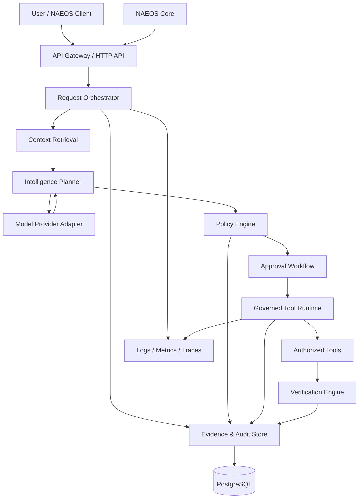

# NAEOS Intelligence — System Architecture

**Document ID:** NAEOS-INT-ARCH-001  
**Version:** 0.1.0  
**Status:** Draft Proposed  
**Audience:** Maintainers, architects, contributors, and security reviewers

---

## 1. Purpose

This document describes the proposed system architecture of NAEOS Intelligence.

It establishes component boundaries, request processing flow, governance enforcement, integration interfaces, and architectural constraints for the MVP.

This document is governed by `DOCUMENTATION-AUTHORITY.md` and must remain consistent with `PROJECT-VISION.md` and `PROJECT-SCOPE.md`.

## 2. Architectural Goals

The architecture MUST:

- Separate intelligence generation from authorization.
- Provide stable, versioned API contracts.
- Support independently testable modules.
- Enforce least-privilege access.
- Record security-relevant decisions and execution events.
- Support provider abstraction.
- Fail closed when authorization or policy evaluation is unavailable.
- Allow future integration with NAEOS Core without tight coupling.

## 3. Architectural Style

The MVP adopts a **Modular Monolith**.

The service is deployed as one application while maintaining explicit internal module boundaries.

This approach reduces early operational complexity and avoids premature microservice decomposition.

The architecture is API-first and contract-oriented.

## 4. High-Level Architecture



The diagram represents a logical architecture. It does not imply that every component is a separate deployable service.

## 5. Core Components

### 5.1 API Layer

Responsibilities:

- Accept authenticated requests.
- Validate request schemas.
- Enforce API versioning.
- Apply request limits.
- Generate request identifiers.
- Return structured responses.

The API layer MUST NOT treat model output as authorization.

### 5.2 Request Orchestrator

Responsibilities:

- Manage request lifecycle.
- Coordinate context retrieval and planning.
- Track execution states.
- Enforce workflow transitions.
- Handle timeouts and cancellation.
- Produce final request results.

The orchestrator coordinates components but does not independently grant permissions.

### 5.3 Context Retrieval

Responsibilities:

- Retrieve relevant information from approved sources.
- Apply source-level access controls.
- Record source provenance.
- Normalize retrieved context.
- Prevent unauthorized context exposure.

Retrieved data MUST be treated as untrusted input.

### 5.4 Intelligence Planner

Responsibilities:

- Classify intent.
- Generate structured plans.
- Identify dependencies.
- Define expected outcomes.
- Identify risks and uncertainties.

The planner proposes actions. It does not authorize or execute them.

### 5.5 Model Provider Adapter

Responsibilities:

- Abstract model provider interfaces.
- Handle model invocation.
- Apply timeout and retry rules.
- Normalize provider responses.
- Record provider metadata.

Provider-specific behavior MUST remain behind an explicit adapter interface.

### 5.6 Policy Engine

Responsibilities:

- Evaluate proposed actions.
- Check applicable policies.
- Validate action targets and constraints.
- Determine approval requirements.
- Produce explicit authorization decisions.

The policy engine MUST be independent of model-generated claims.

An unavailable, invalid, or indeterminate policy decision MUST result in denial.

### 5.7 Approval Workflow

Responsibilities:

- Request human approval when required.
- Associate approvals with specific action proposals.
- Record approver identity and decision.
- Enforce approval expiration.
- Prevent approval reuse for materially different actions.

Approval MUST be bound to the action, target, relevant parameters, and policy context.

### 5.8 Governed Tool Runtime

Responsibilities:

- Execute only authorized actions.
- Validate tool inputs.
- Enforce permissions.
- Revalidate authorization at the final controllable boundary.
- Apply execution limits.
- Record execution outcomes.

The runtime MUST NOT execute arbitrary model-generated commands.

### 5.9 Verification Engine

Responsibilities:

- Evaluate execution outcomes against expected results.
- Retrieve independent observations where available.
- Distinguish success, failure, and inconclusive outcomes.
- Produce verification evidence.

A tool response alone MUST NOT automatically be treated as independent verification.

### 5.10 Evidence and Audit Store

Responsibilities:

- Persist request records.
- Persist policy decisions.
- Persist approval records.
- Persist execution events.
- Persist verification results.
- Maintain traceability between lifecycle stages.

The audit trail MUST distinguish proposals, authorization decisions, execution events, and observations.

## 6. Request Lifecycle

The proposed request lifecycle is:

1. Request received.
2. Authentication and schema validation.
3. Intent classification.
4. Context retrieval.
5. Plan generation.
6. Policy evaluation.
7. Approval, if required.
8. Final authorization revalidation.
9. Governed execution.
10. Independent observation and verification.
11. Evidence persistence.
12. Result returned.

Each stage MUST have an explicit state and failure behavior.

## 7. State Model

The architecture describes the proposed target lifecycle; it does not assert that each state is implemented or enabled in the read-only MVP. The current API/lifecycle implementation record uses `accepted`, `queued`, `running`, `completed`, `failed`, and `cancelled`; scheduling, worker execution, and approval remain separately gated capabilities. Refer to `docs/specifications/REQUEST-LIFECYCLE.md` for the lifecycle vocabulary and implementation boundary.

Target processing stages (not a persisted-state enum):

| Stage | Description |
|---|---|
| `authentication_validation` | Authentication and request schema validation |
| `context_retrieval` | Relevant authorized context is retrieved |
| `planning` | A proposed plan is generated |
| `policy_evaluation` | Proposed actions are evaluated |
| `approval` | Human approval is obtained when required |
| `authorization_revalidation` | Authorization is checked at the final controllable boundary |
| `execution` | Authorized runtime carries out supported actions |
| `verification` | Outcomes are evaluated against evidence |
| `finalization` | Results and required evidence are persisted |

These stages are conceptual processing steps and must not be confused with request state values. State transitions MUST be validated by the orchestrator. A request MUST NOT transition into consequential execution without policy evaluation, required approval, and final authorization revalidation.

## 8. Integration with NAEOS Core

NAEOS Intelligence integrates with NAEOS Core through versioned contracts.

The integration MUST:

- Use documented API interfaces.
- Authenticate service-to-service requests.
- Validate request and response schemas.
- Preserve request correlation identifiers.
- Apply explicit timeout and retry behavior.
- Avoid importing NAEOS Core internal implementation packages.
- Maintain compatibility rules for contract versions.

The exact integration contract remains subject to review against the actual NAEOS Core repository.

## 9. Proposed Technology Direction

| Concern | Initial Direction |
|---|---|
| Implementation language | Go |
| API | REST with OpenAPI |
| Persistence | PostgreSQL |
| Model integration | Provider adapter interface |
| Deployment | Containerized service |
| Observability | OpenTelemetry-compatible instrumentation |
| CI/CD | GitHub Actions |
| Configuration | Environment variables with validated configuration |
| Testing | Unit, integration, contract, and security tests |

These are proposed technology choices, not finalized architecture decisions.

## 10. Repository Module Boundaries

Proposed internal modules:

```text
naeos-intelligence/
├── cmd/
│   └── intelligence/
├── internal/
│   ├── api/
│   ├── orchestrator/
│   ├── context/
│   ├── planner/
│   ├── model/
│   ├── policy/
│   ├── approval/
│   ├── runtime/
│   ├── verification/
│   ├── evidence/
│   └── observability/
├── api/
│   └── openapi/
├── migrations/
├── tests/
│   ├── integration/
│   ├── contract/
│   └── security/
└── docs/
```

This structure is illustrative and should be finalized after the repository bootstrap and module dependency review.

## 11. Security Boundaries

The following boundaries are mandatory:

- The model cannot grant itself permissions.
- The planner cannot bypass policy evaluation.
- The runtime cannot execute unauthorized actions.
- Approval cannot be reused outside its bound action.
- Context retrieval cannot bypass source access controls.
- Audit records cannot be replaced by model-generated summaries.
- Policy evaluation failures must fail closed.
- External or irreversible actions require final authorization revalidation.

## 12. Failure Handling

The system MUST define behavior for:

- Model provider unavailable.
- Context source unavailable.
- Invalid model output.
- Policy engine unavailable.
- Approval timeout.
- Tool execution failure.
- Verification inconclusive.
- Database or evidence persistence failure.
- Unsupported API or policy version.

Security-critical failures MUST NOT result in implicit authorization.

Where durable evidence is required, the system MUST NOT report a security-sensitive action as successfully completed if its required evidence cannot be persisted.

## 13. Observability

The system SHOULD provide:

- Structured logs.
- Request correlation IDs.
- Distributed traces.
- Metrics for request latency and failure rates.
- Model invocation metrics.
- Policy decision metrics.
- Tool execution metrics.
- Approval latency metrics.

Sensitive data, credentials, and unnecessary user content MUST NOT be exposed in logs.

## 14. Testing Strategy

The architecture SHOULD be validated through:

- Unit tests for module behavior.
- Integration tests for orchestration.
- Contract tests for NAEOS Core integration.
- Policy tests for authorization decisions.
- Security tests for privilege boundaries.
- Failure-injection tests.
- End-to-end tests for request lifecycle.
- Verification tests for evidence integrity.

Tests MUST include denied actions, approval expiration, invalid model output, and policy-engine failure.

## 15. Architecture Decision Records

Significant architectural decisions SHOULD be documented under:

`docs/architecture/adr/`

Each ADR SHOULD include:

- Context.
- Decision.
- Alternatives considered.
- Consequences.
- Security implications.
- Status.

## 16. Open Questions

The following decisions require further review:

- Exact authentication mechanism for service-to-service integration.
- Policy representation and evaluation technology.
- Approval persistence and identity model.
- Tool registry and capability schema.
- Evidence retention and integrity mechanism.
- Synchronous versus asynchronous request execution.
- NAEOS Core integration contract.
- Deployment and secret-management strategy.

These questions MUST be resolved before the corresponding implementation becomes production-critical.

## 17. Document Governance

This document is governed by `DOCUMENTATION-AUTHORITY.md`.

Changes affecting module boundaries, authorization, execution, persistence, or integration contracts SHOULD be accompanied by an Architecture Decision Record.
