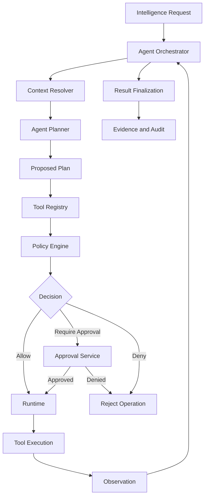

# AGENT EXECUTION MODEL

**Project:** NAEOS Intelligence  
**Document ID:** NAEOS-INT-AGENT-001  
**Location:** `docs/specifications/AGENT-EXECUTION-MODEL.md`  
**Status:** Draft Proposed  
**Version:** 0.1.0  
**Last Updated:** 2026-11-04

---

## 1. Purpose

This document defines the execution model for intelligent agents within NAEOS Intelligence.

It establishes how an agent:

- Receives an intelligence request.
- Interprets the request.
- Constructs an execution plan.
- Selects permitted tools.
- Requests policy evaluation.
- Interacts with the runtime.
- Observes execution outcomes.
- Produces results and evidence.
- Handles failures and approval requirements.

The execution model must ensure that agent intelligence remains separate from authorization and runtime execution.

## 2. Core Principles

The agent execution model MUST follow these principles:

1. Agents operate within explicitly defined scopes.
2. Agent-generated plans are proposals.
3. Agents do not independently authorize operations.
4. Tool access must be explicitly registered and controlled.
5. Runtime execution requires policy authorization.
6. Consequential operations require approval when mandated by policy.
7. Agents must not obtain unrestricted system access.
8. Every tool invocation must be traceable.
9. Agent execution must be bounded by resource and time limits.
10. Agent outputs must distinguish claims from verified observations.
11. Agents must not modify their own security boundaries.
12. Agent failures must not result in unauthorized execution.

## 3. Architectural Position

The Agent Execution Model operates within the Intelligence Engine.

### Responsibility Separation

| Component | Responsibility |
|---|---|
| Agent Orchestrator | Controls agent lifecycle and workflow |
| Agent Planner | Generates proposed plans |
| Context Resolver | Retrieves authorized context |
| Tool Registry | Defines available tool capabilities |
| Policy Engine | Evaluates proposed operations |
| Approval Service | Records human approval |
| Runtime | Executes authorized operations |
| Observation Layer | Captures execution results |
| Result Finalizer | Produces the final intelligence output |
| Audit System | Records governance events |

The agent must not bypass these component boundaries.

## 4. Agent Definition

An agent is a controlled intelligence component operating under a defined configuration.

A conceptual agent definition includes:

| Field | Description |
|---|---|
| `agent_id` | Stable agent identifier |
| `name` | Agent name |
| `description` | Agent purpose |
| `version` | Agent configuration version |
| `capability_profile` | Permitted capability references |
| `tool
