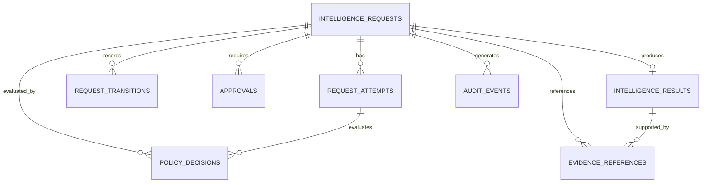

# DATA MODEL

**Project:** NAEOS Intelligence  
**Document ID:** NAEOS-INT-DATA-001  
**Location:** `docs/specifications/DATA-MODEL.md`  
**Status:** Draft Proposed  
**Version:** 0.1.0  
**Last Updated:** 2026-11-04

---

## 1. Purpose

This document defines the proposed persistent data model for NAEOS Intelligence.

The model supports:

- Intelligence request management.
- Request lifecycle tracking.
- Processing attempts and retry management.
- Approval workflows.
- Policy decision records.
- Intelligence results.
- Evidence references.
- Audit events.
- Multi-client and tenant isolation where applicable.

The data model must preserve the separation between intelligence outputs, policy authorization, runtime execution, and audit evidence.

## 2. Data Model Principles

The data model MUST follow these principles:

1. Every primary resource must have a stable identifier.
2. Every intelligence request must have a recorded lifecycle state.
3. State transitions must be auditable.
4. Approval records must be bound to the proposal being approved.
5. Policy decisions must be recorded independently from model outputs.
6. Execution evidence must be distinguishable from model-generated claims.
7. Sensitive data must be minimized.
8. Resource access must be scoped to authorized clients or tenants.
9. Database constraints must enforce critical integrity requirements.
10. The model must support recovery after service interruption.
11. Retention and deletion must follow approved policies.
12. No persisted model output must be treated as authorization by itself.

## 3. Database Technology

The initial proposed database is PostgreSQL.

PostgreSQL is selected as the preferred MVP persistence technology because it supports:

- Relational integrity.
- Transactions.
- JSONB for controlled flexible metadata.
- Indexing and query optimization.
- Durable persistence.
- Structured audit records.

The final database configuration must be validated against deployment requirements.

## 4. Entity Overview

The initial model contains the following conceptual entities:

| Entity | Purpose |
|---|---|
| `intelligence_requests` | Stores submitted intelligence requests |
| `request_attempts` | Tracks individual processing attempts |
| `request_transitions` | Records lifecycle state transitions |
| `approvals` | Stores approval requests and decisions |
| `policy_decisions` | Records policy evaluation outcomes |
| `intelligence_results` | Stores finalized intelligence outputs |
| `evidence_references` | Stores references to supporting evidence |
| `audit_events` | Stores security and governance audit events |

## 5. Entity Relationships

The diagram represents the proposed conceptual relationships. Exact cardinality and foreign key behavior must be validated during implementation.

## 6. Common Data Fields

Persistent entities should use consistent conventions.

| Field | Type | Description |
|---|---|---|
| `id` | UUID | Stable resource identifier |
| `created_at` | TIMESTAMPTZ | Creation timestamp |
| `updated_at` | TIMESTAMPTZ | Last modification timestamp, where applicable |
| `tenant_id` | UUID | Tenant scope, if multi-tenancy is enabled |
| `client_id` | TEXT | Client identity associated with the resource |

### Timestamp Requirements

- All timestamps must be stored in UTC.
- API timestamps must use ISO 8601 / RFC 3339 format.
- System-generated timestamps must not be supplied by untrusted clients.
- Historical transition timestamps must remain immutable.

## 7. Intelligence Requests

### Table: `intelligence_requests`

Stores the primary record for each intelligence request.

| Field | Type | Required | Description |
|---|---|---|---|
| `id` | UUID | Yes | Primary identifier |
| `tenant_id` | UUID | Conditional | Tenant scope |
| `client_id` | TEXT | Yes | Submitting client identity |
| `purpose` | TEXT | Yes | Request objective |
| `execution_mode` | TEXT | Yes | `analysis_only` or `governed` |
| `status` | TEXT | Yes | Current lifecycle state |
| `context_sources` | JSONB | No | Authorized context references |
| `desired_outputs` | JSONB | No | Requested output types |
| `metadata` | JSONB | No | Non-sensitive metadata |
| `idempotency_key` | TEXT | No | Submission deduplication key |
| `created_at` | TIMESTAMPTZ | Yes | Creation timestamp |
| `updated_at` | TIMESTAMPTZ | Yes | Last update timestamp |
| `completed_at` | TIMESTAMPTZ | No | Completion timestamp |
| `deadline_at` | TIMESTAMPTZ | No | Request deadline |

### Constraints

- `id` must be unique.
- `client_id` must be present.
- `execution_mode` must be validated against supported values.
- `status` must be validated against the lifecycle state model.
- Idempotency keys must be scoped to the authenticated client.
- Terminal state transitions must be validated by the lifecycle implementation.

## 8. Request Attempts

### Table: `request_attempts`

Stores individual processing attempts.

| Field | Type | Required | Description |
|---|---|---|---|
| `id` | UUID | Yes | Attempt identifier |
| `request_id` | UUID | Yes | Parent request |
| `attempt_number` | INTEGER | Yes | Sequential attempt number |
| `status` | TEXT | Yes | Attempt status |
| `started_at` | TIMESTAMPTZ | No | Attempt start |
| `finished_at` | TIMESTAMPTZ | No | Attempt completion |
| `failure_category` | TEXT | No | Failure classification |
| `failure_detail` | TEXT | No | Sanitized diagnostic detail |
| `worker_id` | TEXT | No | Processing worker identifier |
| `created_at` | TIMESTAMPTZ | Yes | Record creation timestamp |

### Constraints

- `request_id` must reference an existing request.
- `(request_id, attempt_number)` must be unique.
- Attempt records must not overwrite previous attempt history.
- Failure details must not contain secrets.

## 9. Request Transitions

### Table: `request_transitions`

Stores lifecycle transition history.

| Field | Type | Required | Description |
|---|---|---|---|
| `id` | UUID | Yes | Transition identifier |
| `request_id` | UUID | Yes | Parent request |
| `from_status` | TEXT | No | Previous state |
| `to_status` | TEXT | Yes | New state |
| `event_type` | TEXT | Yes | Triggering event |
| `actor_type` | TEXT | Yes | Actor category |
| `actor_id` | TEXT | No | Actor identifier |
| `reason` | TEXT | No | Safe transition explanation |
| `correlation_id` | TEXT | No | Correlation identifier |
| `created_at` | TIMESTAMPTZ | Yes | Transition timestamp |

### Requirements

- Every valid transition must create a transition record.
- Transition records must be append-only.
- State updates and transition records must be committed atomically.
- Invalid transitions must be rejected.
- Transition history must not be modified through ordinary API operations.

## 10. Approvals

### Table: `approvals`

Stores approval requests and decisions.

| Field | Type | Required | Description |
|---|---|---|---|
| `id` | UUID | Yes | Approval identifier |
| `request_id` | UUID | Yes | Parent request |
| `proposal_hash` | TEXT | Yes | Integrity reference for approved proposal |
| `policy_decision_id` | UUID | No | Related policy decision |
| `status` | TEXT | Yes | Approval status |
| `approver_id` | TEXT | No | Approver identity |
| `decision_reason` | TEXT | No | Decision explanation |
| `created_at` | TIMESTAMPTZ | Yes | Approval creation timestamp |
| `expires_at` | TIMESTAMPTZ | No | Approval expiration |
| `decided_at` | TIMESTAMPTZ | No | Decision timestamp |

### Approval Status Values

- `pending`
- `approved`
- `denied`
- `expired`
- `cancelled`

### Requirements

- Approval must be bound to a specific proposal.
- Approval must not be inferred from request submission.
- Material proposal changes must invalidate the previous approval.
- Approval decisions must be auditable.
- An expired approval must not authorize execution.

## 11. Policy Decisions

### Table: `policy_decisions`

Stores policy evaluation records.

| Field | Type | Required | Description |
|---|---|---|---|
| `id` | UUID | Yes | Policy decision identifier |
| `request_id` | UUID | Yes | Parent request |
| `attempt_id` | UUID | No | Related processing attempt |
| `policy_version` | TEXT | Yes | Policy version evaluated |
| `decision` | TEXT | Yes | Evaluation outcome |
| `reason_code` | TEXT | No | Stable decision reason |
| `decision_context` | JSONB | No | Sanitized evaluation context |
| `created_at` | TIMESTAMPTZ | Yes | Decision timestamp |

### Decision Values

- `allow`
- `deny`
- `require_approval`

### Requirements

- Policy decisions must be stored independently from model outputs.
- The evaluated policy version must be recorded.
- Policy evaluation failure must not produce an implicit `allow`.
- A decision must be traceable to the associated request.
- Decision records must be append-only.

## 12. Intelligence Results

### Table: `intelligence_results`

Stores finalized intelligence outputs.

| Field | Type | Required | Description |
|---|---|---|---|
| `id` | UUID | Yes | Result identifier |
| `request_id` | UUID | Yes | Parent request |
| `result_version` | INTEGER | Yes | Result version |
| `summary` | TEXT | No | Result summary |
| `outputs` | JSONB | Yes | Structured output references or content |
| `model_provider` | TEXT | No | Provider identifier |
| `model_version` | TEXT | No | Model version |
| `created_at` | TIMESTAMPTZ | Yes | Result creation timestamp |

### Requirements

- Results must be associated with a request.
- Result versions must be distinguishable.
- Results must not be treated as policy authorization.
- Model-generated claims must be distinguishable from verified execution outcomes.
- Sensitive output content must be protected according to data classification.

## 13. Evidence References

### Table: `evidence_references`

Stores references to supporting evidence.

| Field | Type | Required | Description |
|---|---|---|---|
| `id` | UUID | Yes | Evidence reference identifier |
| `request_id` | UUID | Yes | Parent request |
| `result_id` | UUID | No | Associated result |
| `evidence_type` | TEXT | Yes | Evidence category |
| `source_reference` | TEXT | Yes | Source identifier or URI |
| `content_hash` | TEXT | No | Integrity hash |
| `observed_at` | TIMESTAMPTZ | No | Observation timestamp |
| `created_at` | TIMESTAMPTZ | Yes | Record creation timestamp |

### Evidence Requirements

- Evidence references must identify their source.
- Evidence references must not be interpreted as proof without validation.
- Source access must remain subject to authorization.
- Evidence integrity must be verifiable where applicable.
- Evidence records must not contain unnecessary sensitive data.

## 14. Audit Events

### Table: `audit_events`

Stores governance and security-related events.

| Field | Type | Required | Description |
|---|---|---|---|
| `id` | UUID | Yes | Event identifier |
| `request_id` | UUID | No | Related request |
| `tenant_id` | UUID | Conditional | Tenant scope |
| `actor_type` | TEXT | Yes | Actor category |
| `actor_id` | TEXT | No | Actor identifier |
| `event_type` | TEXT | Yes | Event category |
| `event_data` | JSONB | No | Sanitized event metadata |
| `correlation_id` | TEXT | No | Correlation identifier |
| `created_at` | TIMESTAMPTZ | Yes | Event timestamp |

### Audit Requirements

- Audit events must be append-only.
- Audit events must not contain secrets.
- Access to audit records must be restricted.
- Sensitive event data must be minimized.
- Audit integrity and retention must follow the security requirements.

## 15. Data Integrity and Transactions

The implementation must ensure:

- Request creation is atomic.
- Request state updates and transition records are atomic.
- Approval decisions and corresponding state transitions are atomic where applicable.
- Foreign key relationships are enforced.
- Unique constraints prevent duplicate records where required.
- Concurrent updates do not produce invalid lifecycle transitions.

Optimistic concurrency control or database locking may be used where appropriate.

## 16. Indexing Strategy

The initial database implementation should evaluate indexes for:

- Request ID.
- Client ID.
- Tenant ID, if applicable.
- Request status.
- Request creation timestamp.
- Request deadline.
- Request attempt number.
- Approval status and expiration.
- Policy decision request reference.
- Evidence request reference.
- Audit event request reference.
- Idempotency key scoped to client identity.

Index selection must be validated against actual query patterns.

## 17. Data Retention and Deletion

The data model must support approved retention policies.

Retention requirements must consider:

- Intelligence request metadata.
- Request and transition history.
- Processing attempts.
- Approval records.
- Policy decisions.
- Results.
- Evidence references.
- Audit events.

Deletion must not silently remove records required for security, compliance, or auditability.

The final retention durations remain an implementation and governance decision.

## 18. Data Isolation

Where multi-tenancy is enabled:

- Every tenant-scoped resource must include tenant context.
- Tenant context must be derived from authenticated identity or trusted authorization context.
- Clients must not be permitted to override tenant ownership arbitrarily.
- Database queries must enforce tenant isolation.
- Cross-tenant access must be explicitly authorized.

Tenant isolation must be tested as part of the security test suite.

## 19. Migration Strategy

Database schema changes must be managed through versioned migrations.

Migration requirements:

- Migrations must be reproducible.
- Migration files must be reviewed.
- Schema changes must be tested in CI.
- Destructive migrations require explicit review.
- Rollback or recovery procedures must be documented.
- Production migrations must not
