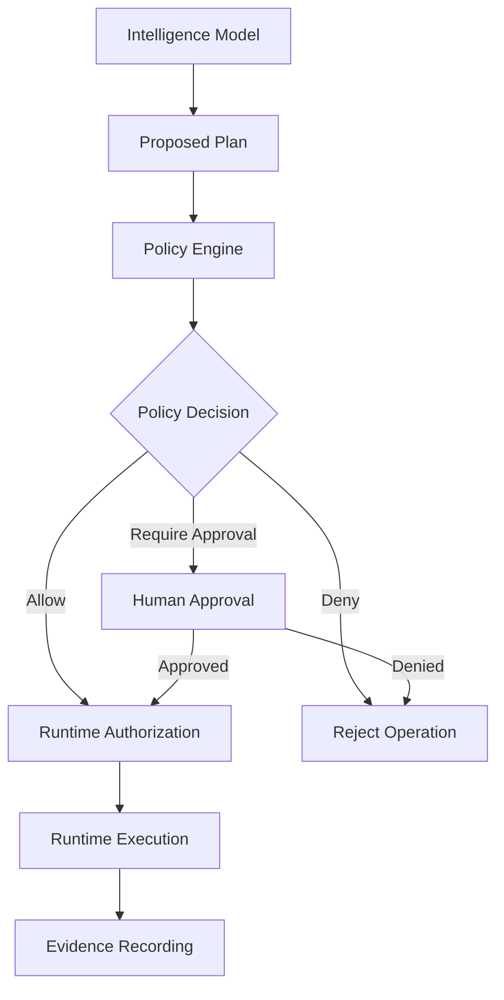

# POLICY ENGINE SPECIFICATION

**Project:** NAEOS Intelligence  
**Document ID:** NAEOS-INT-POLICY-001  
**Location:** `docs/specifications/POLICY-ENGINE-SPECIFICATION.md`  
**Status:** Draft Proposed  
**Version:** 0.1.0  
**Last Updated:** 2026-11-04

---

## 1. Purpose

This document defines the functional and security requirements of the NAEOS Intelligence Policy Engine.

The Policy Engine evaluates proposed operations and determines whether they may proceed within the system's authorized capabilities.

It establishes:

- Policy evaluation principles.
- Decision outcomes.
- Policy inputs and outputs.
- Approval requirements.
- Policy precedence.
- Enforcement boundaries.
- Failure behavior.
- Policy versioning.
- Auditability.
- Testing requirements.

The Policy Engine is a security and governance component. It must not be implemented as an informal prompt instruction to a language model.

## 2. Core Principles

The Policy Engine MUST follow these principles:

1. Policy decisions must be deterministic for equivalent policy inputs and policy versions, except where explicitly defined otherwise.
2. Model-generated plans must not be treated as authorization.
3. The Policy Engine must be logically separated from the intelligence model.
4. Runtime execution must require a valid authorization decision.
5. Denied operations must not be executed.
6. Approval requirements must be explicit.
7. Policy evaluation must fail closed.
8. Every decision must be traceable.
9. Policy rules must be versioned.
10. Policy updates must be reviewed and controlled.
11. The Policy Engine must enforce least privilege.
12. The Policy Engine must not grant capabilities that the runtime does not support.

## 3. Architectural Position

The Policy Engine operates between proposed intelligence actions and runtime execution.

### Responsibility Separation

| Component | Responsibility |
|---|---|
| Intelligence Model | Proposes plans and operations |
| Policy Engine | Evaluates authorization |
| Approval Service | Records human approval decisions |
| Runtime | Executes authorized operations |
| Evidence System | Records execution evidence |
| Audit System | Records governance events |

The Policy Engine must not execute operations directly.

The intelligence model must not modify policy rules.

## 4. Policy Decision Outcomes

The initial Policy Engine supports three decision outcomes.

### 4.1 `allow`

The proposed operation is permitted by the applicable policy.

An `allow` decision means the operation may proceed to runtime authorization checks.

It does not eliminate runtime verification requirements.

### 4.2 `deny`

The proposed operation is prohibited.

A `deny` decision must prevent execution.

The denial must include a stable reason code and an auditable record.

### 4.3 `require_approval`

The proposed operation requires human approval before execution.

The operation must remain blocked until:

- The required approval is granted.
- The approval is bound to the proposed operation.
- The approval remains valid.
- Runtime authorization checks succeed.

Approval does not override a policy denial.

## 5. Policy Evaluation Inputs

The Policy Engine must evaluate a structured policy context.

### Required Input Categories

| Input | Description |
|---|---|
| `request_id` | Associated intelligence request |
| `operation_id` | Unique proposed operation |
| `operation_type` | Category of operation |
| `operation_parameters` | Sanitized operation parameters |
| `actor_identity` | Authenticated principal |
| `resource_scope` | Target resource and ownership scope |
| `execution_mode` | Requested execution mode |
| `policy_version` | Policy version to evaluate |
| `approval_context` | Relevant approval state |
| `risk_context` | Risk classification and supporting context
