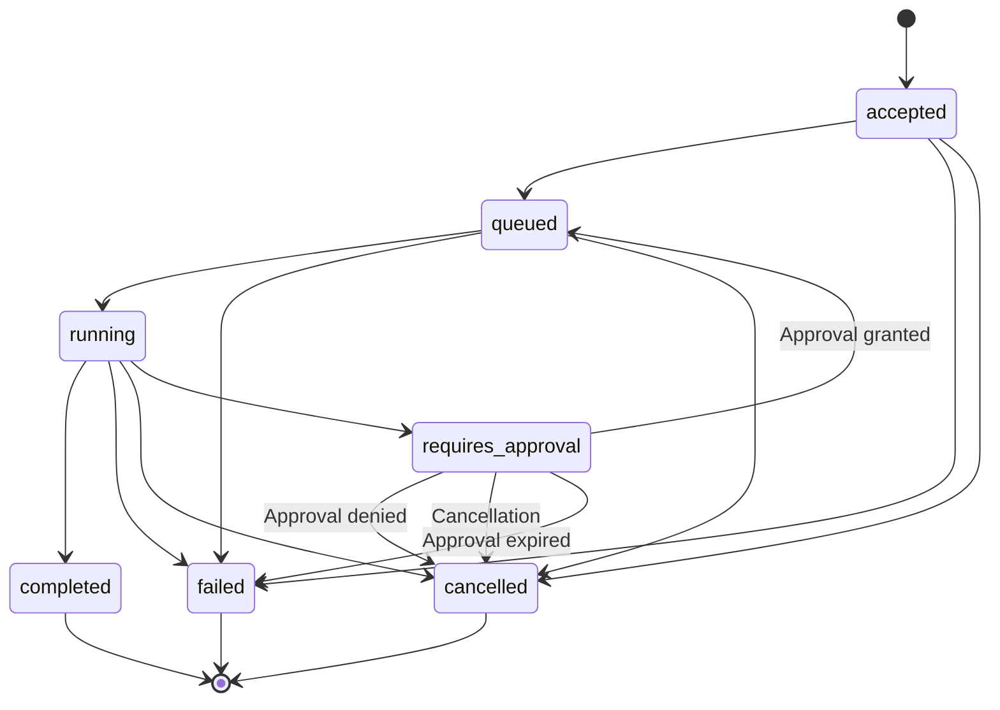

# REQUEST LIFECYCLE

**Project:** NAEOS Intelligence  
**Document ID:** NAEOS-INT-SPEC-003  
**Location:** `docs/specifications/REQUEST-LIFECYCLE.md`  
**Status:** Draft Proposed (target lifecycle; MVP implementation subset is documented in Phase 3)  
**Version:** 0.1.0  
**Last Updated:** 2026-11-04

---

## 1. Purpose

This document defines the lifecycle of intelligence requests within NAEOS Intelligence.

It specifies:

- Request state transitions.
- Processing stages.
- Approval requirements.
- Cancellation behavior.
- Retry and timeout policies.
- Failure handling.
- Lifecycle invariants.
- Observability requirements.

The lifecycle must be deterministic, auditable, and consistent with the NAEOS Intelligence architecture and security requirements.

## 2. Core Principles

The request lifecycle MUST follow these principles:

1. Every request has a unique identifier.
2. Every request has an explicit lifecycle state.
3. Every state transition must be validated.
4. A request must not bypass policy enforcement.
5. Model-generated plans are proposals, not authorization.
6. Runtime execution requires explicit policy authorization.
7. Consequential actions require human approval when mandated by policy.
8. Every consequential operation must be auditable.
9. Retries must not create unintended duplicate actions.
10. Failure must not result in unauthorized execution.
11. Cancellation must be handled explicitly.
12. Terminal states must be immutable unless a documented administrative correction mechanism exists.

## 3. Request State Model

The state vocabulary below describes the **proposed target lifecycle**. It is not a statement that every state or transition is implemented or enabled in the read-only MVP.

**MVP implementation boundary (Phase 3):** submission is accepted into `accepted`; the current service does not schedule or run intelligence processing. The public API therefore must not imply `queued`, `running`, or `completed` as a consequence of submission. Cancellation is currently limited to requests not entered into execution; running-work cancellation and propagation are deferred. `requires_approval` and approval transitions are reserved for a separately accepted governed workflow and are not enabled in the MVP.

The initial target lifecycle uses the following states:

| State | Category | Description |
|---|---|---|
| `accepted` | Initial | Request passed initial API validation |
| `queued` | Active | Request is waiting for processing |
| `running` | Active | Request is being processed |
| `requires_approval` | Suspended | Processing requires explicit approval |
| `completed` | Terminal | Request completed successfully |
| `failed` | Terminal | Request failed |
| `cancelled` | Terminal | Request was cancelled |

### 3.1 State Categories

**Initial state**

`accepted`

**Active states**

- `queued`
- `running`

**Suspended state**

- `requires_approval`

**Terminal states**

- `completed`
- `failed`
- `cancelled`

A terminal request must not return to an active state.

## 4. State Transition Model

The following transitions are permitted:

| Current State | Event | Next State |
|---|---|---|
| `accepted` | Scheduling accepted | `queued` |
| `accepted` | Validation or processing failure | `failed` |
| `accepted` | Cancellation accepted | `cancelled` |
| `queued` | Worker claims request | `running` |
| `queued` | Cancellation accepted | `cancelled` |
| `queued` | Processing failure | `failed` |
| `running` | Processing succeeds | `completed` |
| `running` | Approval required | `requires_approval` |
| `running` | Processing fails | `failed` |
| `running` | Cancellation completes | `cancelled` |
| `requires_approval` | Approval granted | `queued` |
| `requires_approval` | Approval denied | `cancelled` |
| `requires_approval` | Approval expires | `failed` |
| `requires_approval` | Cancellation accepted | `cancelled` |

This transition table is **proposed for the target lifecycle**, not normative for the currently implemented read-only MVP. Only behavior explicitly described in the Phase 3 implementation record and API/OpenAPI contract is considered implemented. In particular, the approval transitions are deferred and running cancellation is not implemented.

Before this target transition table becomes normative, its states, transition guards, and terminal-state behavior must be accepted and contract-tested against the implementation.

Any additional transition requires an architecture review and an update to this document.

## 5. Lifecycle Diagram

## 6. Processing Stages

A request follows the stages below.

### Stage 1 — Submission

The API receives an intelligence request.

The system must:

- Authenticate the client.
- Authorize the submission.
- Validate the request schema.
- Validate referenced context sources.
- Apply request size and rate limits.
- Assign a unique request identifier.
- Record the submission event.

If initial validation fails, the request must be rejected before entering the processing lifecycle.

### Stage 2 — Acceptance

The system transitions the request to `accepted`.

The acceptance operation must:

- Persist the request.
- Establish its ownership and authorization context.
- Record the request creation timestamp.
- Preserve the idempotency key, when supplied.
- Return the request identifier.

Acceptance does not indicate that analysis has completed.

### Stage 3 — Scheduling

The scheduler transitions the request to `queued`.

The scheduling mechanism must support:

- Controlled concurrency.
- Resource limits.
- Retry eligibility.
- Request prioritization, where permitted.
- Isolation between clients or tenants, where applicable.

Scheduling must not bypass authorization or policy enforcement.

### Stage 4 — Context Resolution

The runtime resolves the authorized context sources.

The system must:

- Validate source access.
- Retrieve only permitted information.
- Record relevant source references.
- Apply data handling restrictions.
- Reject unauthorized source access.

Context resolution must not grant additional privileges to the request.

### Stage 5 — Intelligence Processing

The intelligence engine performs the requested analysis.

The model may:

- Analyze supplied context.
- Identify risks.
- Generate recommendations.
- Propose plans.
- Produce structured outputs.

The model must not independently authorize consequential actions.

### Stage 6 — Policy Evaluation

Generated plans and proposed operations must be evaluated against applicable policy.

The policy evaluation must determine whether a proposal is:

- Permitted.
- Denied.
- Requires approval.
- Outside the system's supported capability.

A policy evaluation failure must fail closed.

### Stage 7 — Approval

If approval is required, the request transitions to `requires_approval`.

The system must record:

- Approval requirement.
- Proposed action or plan.
- Approval request identifier.
- Approver identity, when known.
- Approval deadline.
- Approval decision.
- Decision timestamp.

Approval must be bound to the exact proposed action or plan.

A materially changed proposal must require a new approval decision.

### Stage 8 — Governed Execution

Where execution is supported and authorized:

- The runtime must verify policy authorization.
- The runtime must verify approval requirements.
- The runtime must enforce capability restrictions.
- The runtime must record execution evidence.
- The runtime must prevent duplicate consequential operations.

The model must not have unrestricted shell, production deployment, or repository mutation access.

### Stage 9 — Result Finalization

The request transitions to `completed` when its required processing is successfully finalized.

The system must persist:

- Result summary.
- Output references.
- Evidence references.
- Relevant policy decisions.
- Completion timestamp.

The result must not claim that an operation succeeded without corresponding runtime evidence.

## 7. Approval Lifecycle

Approval is a separate governed process associated with the request.

### 7.1 Approval Requirements

Approval must be required whenever applicable policy identifies an operation as consequential.

Examples include:

- Repository modifications.
- Pull request creation or merge.
- Production deployment.
- Data deletion.
- External communication.
- Security-sensitive configuration changes.

The MVP must not assume that a model-generated recommendation is approved.

### 7.2 Approval Decisions

Supported decisions:

- `approved`
- `denied`
- `expired`

The approval record must include the identity of the decision-maker and the decision timestamp.

### 7.3 Approval Integrity

Approval must be bound to:

- Request identifier.
- Proposed operation.
- Relevant operation parameters.
- Policy context.
- Approval expiration.

If the proposal changes materially, its previous approval becomes invalid.

### 7.4 Approval Expiration

Expired approval must not authorize execution.

An expired approval must require a new approval decision or terminate the request according to policy.

## 8. Cancellation

Cancellation is a controlled lifecycle operation.

### 8.1 Cancellation Behavior

| Request State | Cancellation Behavior |
|---|---|
| `accepted` | Cancel before scheduling |
| `queued` | Remove from scheduling queue and cancel |
| `running` | Request cooperative cancellation |
| `requires_approval` | Cancel pending approval |
| `completed` | Reject cancellation |
| `failed` | Reject cancellation |
| `cancelled` | Return the existing terminal state |

### 8.2 Running Request Cancellation

For running requests, cancellation must:

- Stop new work from being scheduled.
- Notify active workers.
- Prevent new consequential operations.
- Terminate cancellable operations safely.
- Preserve execution evidence.
- Transition to `cancelled` after cancellation is confirmed.

If an external operation cannot be interrupted, the system must record its status and handle it through the appropriate recovery process.

Cancellation must not be reported as successful while consequential operations remain unaccounted for.

## 9. Retry Policy

Retries are allowed only for failures classified as transient.

### 9.1 Retryable Failures

Examples include:

- Temporary network failure.
- Temporary provider unavailability.
- Recoverable infrastructure errors.
- Temporary resource contention.

### 9.2 Non-Retryable Failures

Examples include:

- Invalid request.
- Authorization failure.
- Policy denial.
- Invalid context reference.
- Unsupported operation.
- Approval denial.
- Permanent schema validation failure.

### 9.3 Retry Controls

Retries must:

- Be bounded.
- Use exponential backoff with jitter.
- Respect request deadlines.
- Preserve request identity.
- Record each attempt.
- Avoid duplicate consequential operations.

The initial retry count and backoff limits are implementation decisions that must be documented before production use.

## 10. Timeout Policy

Timeouts must be defined for:

- API request handling.
- Queue waiting.
- Context resolution.
- Model processing.
- Policy evaluation.
- Approval waiting.
- Runtime execution.

Timeouts must be configurable.

A timeout must not automatically grant permission to continue execution.

### Timeout Behavior

| Stage | Expected Behavior |
|---|---|
| API validation | Reject request if processing exceeds the configured limit |
| Queue waiting | Apply queue deadline policy |
| Context resolution | Fail or retry if eligible |
| Model processing | Terminate or retry if eligible |
| Policy evaluation | Fail closed |
| Approval waiting | Expire approval according to policy |
| Runtime execution | Apply safe cancellation and recovery behavior |

## 11. Failure Handling

All failures must be classified.

### Failure Categories

- `validation_error`
- `authentication_error`
- `authorization_error`
- `context_resolution_error`
- `provider_error`
- `policy_error`
- `approval_error`
- `execution_error`
- `timeout_error`
- `internal_error`

### Failure Requirements

The system must:

- Record the failure category.
- Record a safe diagnostic message.
- Preserve relevant correlation identifiers.
- Avoid exposing secrets.
- Determine whether retry is allowed.
- Transition to `failed` when recovery is not possible.

Policy or authorization failures must not be retried in a manner that bypasses the failed control.

## 12. Lifecycle Invariants

The following invariants are mandatory:

1. Every request must have a unique identifier.
2. Every transition must be validated.
3. Every transition must be recorded.
4. Terminal states must not be reopened through ordinary API operations.
5. A denied operation must not be executed.
6. Approval must not be inferred from request submission.
7. Policy evaluation must precede consequential execution.
8. Execution must be performed by the authorized runtime.
9. Retry must not create duplicate consequential operations.
10. Cancellation must not erase execution evidence.
11. Failure must not result in unauthorized execution.
12. Request ownership and authorization must remain enforced throughout the lifecycle.

## 13. Persistence Requirements

The lifecycle implementation must persist sufficient information to recover and audit requests.

Required conceptual records include:

- Intelligence request.
- Request state.
- State transition history.
- Processing attempt.
- Approval record.
- Policy decision reference.
- Result reference.
- Evidence reference.
- Correlation identifier.

The exact database schema is defined in a separate data model specification.

## 14. Observability

The system must provide observability for lifecycle processing.

### Metrics

Recommended metrics include:

- Request count by state.
- Request completion rate.
- Request failure rate.
- Request cancellation rate.
- Queue waiting duration.
- Processing duration.
- Approval waiting duration.
- Retry count.
- Timeout count.

### Logs

Structured logs should include:

- Request ID.
- Processing attempt ID.
- State transition.
- Event timestamp.
- Correlation ID.
- Safe failure category.

Logs must not include secrets or unrestricted sensitive request content.

### Tracing

Distributed tracing should correlate:

- API submission.
- Scheduling.
- Context resolution.
- Intelligence processing.
- Policy evaluation.
- Approval.
- Runtime execution.
- Result finalization.

## 15. Security and Governance

The lifecycle must remain consistent with:

- `docs/security/THREAT-MODEL.md`
- `docs/security/SECURITY-REQUIREMENTS.md`
- `docs/architecture/SYSTEM-ARCHITECTURE.md`
- `docs/architecture/DATA-FLOW.md`
- `docs/specifications/API-CONTRACT.md`
- `api/openapi.yaml`

The following control separation is mandatory:

**Model proposes → Policy authorizes → Runtime executes → Evidence records**

No lifecycle transition may bypass this separation.

## 16. Acceptance Criteria

The lifecycle specification is ready for implementation when:

- [ ] Request states are defined.
- [ ] Valid state transitions are documented.
- [ ] Terminal states are identified.
- [ ] Approval behavior is specified.
- [ ] Cancellation behavior is specified.
- [ ] Retry behavior is bounded and documented.
- [ ] Timeout handling is defined.
- [ ] Failure categories are defined.
- [ ] Lifecycle invariants are documented.
- [ ] Persistence requirements are identified.
- [ ] Observability requirements are documented.
- [ ] Security requirements are traceable.
- [ ] State transitions can be validated through automated tests.

## 17. Related Documents

- `README.md`
- `DOCUMENTATION-AUTHORITY.md`
- `docs/vision/PROJECT-VISION.md`
- `docs/vision/PROJECT-SCOPE.md`
- `docs/architecture/SYSTEM-ARCHITECTURE.md`
- `docs/architecture/COMPONENT-BOUNDARIES.md`
- `docs/architecture/DATA-FLOW.md`
- `docs/security/THREAT-MODEL.md`
- `docs/security/SECURITY-REQUIREMENTS.md`
- `docs/specifications/API-CONTRACT.md`
- `api/openapi.yaml`

## 18. Next Steps

1. Review and approve the lifecycle state model.
2. Define the persistence data model.
3. Implement the lifecycle state machine.
4. Add transition validation.
5. Add retry and timeout policies.
6. Implement approval handling.
7. Add lifecycle integration tests.
8. Validate failure and cancellation scenarios.

---

**Document Status:** Draft Proposed  
**Version:** 0.1.0  
**Owner:** NAEOS Intelligence Project
